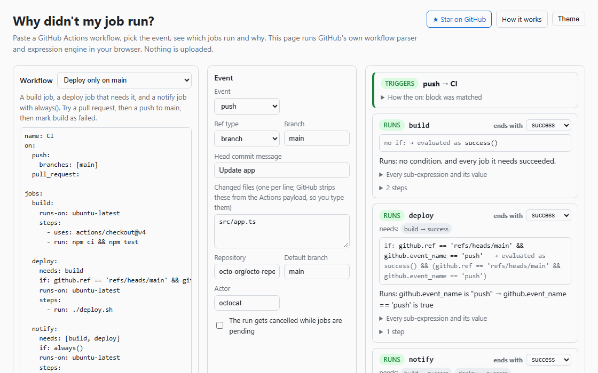

<h1 align="center">Why didn't my job run?</h1>

<p align="center"><b>Paste a GitHub Actions workflow, pick the event, see which jobs run and why.</b><br>GitHub's own workflow parser and expression engine, running in your browser. Nothing is uploaded.</p>

<p align="center">
  <a href="https://barbarkaragul-oss.github.io/why-didnt-my-job-run/">Open the simulator</a> ·
  <a href="#run-it-on-your-own-repository">Run it on your own repository</a> ·
  <a href="#how-it-works">How it works</a> ·
  <a href="#verified-against-real-runs">Verified against real runs</a> ·
  <a href="#limits">Limits</a>
</p>

<p align="center">
  <a href="https://github.com/barbarkaragul-oss/why-didnt-my-job-run/actions/workflows/ci.yml"></a>
  
</p>

<p align="center">
  <a href="https://barbarkaragul-oss.github.io/why-didnt-my-job-run/"></a>
</p>

Every GitHub Actions user has stared at a grey "skipped" job and asked why. The usual answer is a dozen "test ci" commits. This page answers in a second: paste the workflow, choose `push` to `main` or a `pull_request` from a fork with a `release` label or a `workflow_dispatch` with `deploy: true`, and every job turns green or grey with the reason next to it, down to the value of each sub-expression.

```
if: github.event.pull_request.head.repo.fork == false
→ SKIPPED on pull_request from a fork:
  github.event.pull_request.head.repo.fork is true → github.event.pull_request.head.repo.fork == false is false
→ RUNS on push (probably not what you meant):
  github.event.pull_request.head.repo.fork is null → null == false is true
  (loose equality: null and boolean are compared as numbers, null/false/'' count as 0)
```

## What it does

- **Trigger decision.** Does this event start the workflow at all? `on:` filters are applied in the documented order: activity types (and the pull_request default of opened/synchronize/reopened), `branches` / `branches-ignore`, `tags` / `tags-ignore`, `paths` / `paths-ignore`, with GitHub's pattern syntax (`*`, `**`, `?`, `+`, `[]`, `!` negation with ordering). Each rule reports what it matched.
- **Job decisions in dependency order.** Every job's `if:` is evaluated by GitHub's own expression package, including the implicit `success() &&` wrapper its parser adds to a condition that has no status function, with `needs.<job>.result` and the status functions computed from every job upstream: the recorded runs show `success()` and `failure()` look at all ancestors, not only the direct `needs`. Mark a job as failed or cancelled to see what `failure()`, `always()` and `!cancelled()` do downstream.
- **Why.** The decisive comparison is named with both sides' values, and a note explains coercions (`null == false` is true, `inputs.deploy == 'true'` is false for a boolean input, string comparison is case-insensitive). Expand a job to see every sub-expression and its value.
- **Matrix expansion.** A job with `strategy.matrix` becomes the jobs GitHub creates for it, each under the name the run lists (`test (linux, 20)`), with its own `matrix` values and its own step decisions: the cross product, `exclude`, `include` (added to the combinations it fits, or a combination of its own), `fail-fast` (mark one combination as failing and the others are cancelled with GitHub's annotation) and the result the jobs that need it see. A matrix read from a job output (`fromJSON(needs.plan.outputs.list)`) stays unknown until you type that output. When it comes out empty, the card says what GitHub does and does not tell you: no job at all, neither failed nor skipped, and `failure` for every job that needs it.
- **Things GitHub rejects.** `hashFiles()` or `matrix` in a job-level `if:`, `branches` together with `branches-ignore`, unknown keys: the file is reported as GitHub would reject it and every job is marked not run, as the recorded hashFiles runs show (a failed run named after the file, with no jobs, sibling jobs included). A filter list with only negative patterns is different: GitHub creates no run at all, and the trigger card says so.
- **The context you get.** The `github` context for the scenario, derived per event as documented (`refs/pull/N/merge` for pull requests, the base branch for `pull_request_target`, the default branch for `issues` and `schedule`, the tag for `release`), with the GitHub Docs description of every field on hover.
- **Share.** One link carries the workflow and the scenario, compressed into the URL fragment.

## Run it on your own repository

On the page you tell the simulator which files changed. Inside your repository git already knows, so the command line version reads the workflows, the branch, the commit and the changed files from the repository you run it in, and prints what the page would show for every workflow and every job. It needs Node 22 or later and git.

```bash
cd your-repository
npx github:barbarkaragul-oss/why-didnt-my-job-run                        # a push of the last commit on this branch
npx github:barbarkaragul-oss/why-didnt-my-job-run --event pull_request   # this branch as a pull request into the default branch
```

On a branch `fix/login` whose one commit changed two files under `src/`, in a repository with a CI workflow (a test matrix, a deploy job for pushes to main, a preview job for pull requests) and a docs workflow:

```
$ npx github:barbarkaragul-oss/why-didnt-my-job-run --event pull_request
pull_request (opened) from fix/login into main, head ffb7c2e · octo-org/octo-repo · default branch main
2 changed files: git diff origin/main...HEAD (from the merge base 387ef33, as GitHub diffs a pull request)
  src/login.test.ts
  src/login.ts

.github/workflows/ci.yml · CI
  triggers
    on: pull_request is present.
    activity type "opened" is one of the default types.
    paths-ignore: "src/login.test.ts" is not ignored → runs
    paths-ignore: "src/login.ts" is not ignored → runs
  runs      test
                     → no condition, and every job it needs succeeded. The matrix makes 2 jobs.
                     matrix: node [20, 22] · fail-fast: true (default)
                     runs      test (20)
                     runs      test (22)
  skipped   deploy   if: github.event_name == 'push' && github.ref == 'refs/heads/main'
                     → github.event_name is "pull_request" → github.event_name == 'push' is false
  runs      preview  if: github.event_name == 'pull_request' && !github.event.pull_request.head.repo.fork
                     → !github.event.pull_request.head.repo.fork is true

.github/workflows/docs.yml · Docs
  does not trigger
    The workflow does not listen to pull_request (on: push).
  blocked   publish
```

A job is `runs`, `skipped`, `fails` (you marked it with `--fail`), `cancelled` (fail-fast), `blocked` (the event does not start the workflow), `rejected` (GitHub refuses the file, so the run fails with no jobs) or `not-created` (its matrix is empty, so GitHub creates no job and the jobs that need it see `failure`). A matrix job gets one line per job GitHub creates, under the name the run lists. `--json` prints all of it, steps included, for scripts.

| Flag | What it sets |
|---|---|
| `--event <name>` | `push` (default), `pull_request`, `pull_request_target`, `workflow_dispatch`, `schedule`, `release`, `issues`, ... every event the page offers |
| `--action <type>` | the activity type (`opened`, `labeled`, `synchronize`, ...); default as on the page |
| `--branch <name>` | the pushed branch, the pull request's head branch, the branch picked for `workflow_dispatch` |
| `--tag <name>` | a tag push (with `--event push`), or the release's tag |
| `--base <ref>` | push: the commit before the push (default: the head's first parent). pull_request: the branch it targets (default: `origin/HEAD`) |
| `--head <ref>` | the pushed commit, or the pull request's head (default: `HEAD`) |
| `--label <name>`, `--fork`, `--draft`, `--actor <login>` | the pull request or issue, as on the page |
| `--input <key=value>` | a `workflow_dispatch` input, typed by the workflow's input definition (repeatable) |
| `--output <job.key=value>` | an output of a job, for `needs.<job>.outputs.<key>` in a condition or a matrix (repeatable) |
| `--var <NAME=value>` | a configuration variable, for `vars.NAME` (repeatable) |
| `--fail <job>` | that job fails (repeatable); one job of a matrix is named as GitHub lists it, `"test (20)"`, or as `test:20` |
| `--sha`, `--repo <owner/name>`, `--default-branch <name>` | override what is read from git |
| `--workflow <file>` | only this workflow: a path, or a file name in `.github/workflows` (repeatable) |
| `--json` | machine-readable output |
| `--expect-run <job>` | exit with 1 unless that job (or matrix combination) runs (repeatable) |

Exit codes: 0 when the simulation ran and every `--expect-run` job runs, 1 when one of them does not, 2 when the simulation could not be done (not a git repository, an unknown flag or job, a shallow clone without the commit before the head).

**What comes from git, and what is a default.**

| | Where it comes from |
|---|---|
| the workflows | `.github/workflows/*.yml` and `*.yaml` in the working tree, uncommitted edits included, so a change can be tried before it is pushed (GitHub reads them from the pushed commit) |
| changed files, for `paths` and `paths-ignore` | push: `git diff --name-only <base>..<head>`, the base defaulting to the head's first parent, i.e. a push of one commit; `--base origin/main` for a push of several. The first commit of a repository counts every file. Pull request: the diff from the merge base of the base branch and the head (`git diff <base>...<head>`), which is the diff GitHub matches paths against. A rename counts as both paths (not checked against a real run). |
| `github.ref`, `github.ref_name`, `github.head_ref`, `github.base_ref` | the checked-out branch (or `--head`'s), the base branch for a pull request; for `schedule`, `issues` and the other events that always run on the default branch, the default branch |
| `github.sha`, `github.event.before`, `after`, `head_commit.id`, `head_commit.message` | the head commit and the base; for a pull request `github.event.pull_request.head.sha` and `base.sha` (`github.sha` of a pull request run is a merge commit GitHub creates, which does not exist locally) |
| `github.repository`, `github.repository_owner` | the URL of the `origin` remote |
| the default branch | `origin/HEAD`, which `git clone` records; otherwise a `main` or `master` branch that exists, and the output says so |
| `github.workflow`, `github.workflow_ref` | the workflow's `name:`, or its path |
| everything else | the page's defaults: GitHub's example webhook payload for the event, actor `octocat`, run number and attempt 1, the example pull request's number, no labels, not a fork, not a draft |

**What it cannot know.** Secrets: they are never available in `if:`, on GitHub or here. Job outputs: `needs.<job>.outputs.*` is empty unless you pass `--output`, and a matrix read from a job output stays unknown until you do (the CLI prints the flag, with the value the workflow file itself writes when it has one). Configuration variables, unless `--var`. Anything that happens at run time: every job that runs is assumed to succeed unless you `--fail` it, and step conditions that read `steps.*`, `env` or `hashFiles()` are unknown, as on the page. What GitHub itself limits: it looks at only the first 300 files of a diff for paths filters (the output says when there are more), and events such as `workflow_dispatch` and `schedule` only start workflows that exist on the default branch, which the CLI notes but does not check.

**As a check in CI.** `--expect-run` turns a question into an exit code, for example to make sure a change to the workflow keeps `deploy` running on pushes to main:

```yaml
- uses: actions/checkout@v7
  with:
    fetch-depth: 0   # the diff needs the commit before the head
- run: npx --yes github:barbarkaragul-oss/why-didnt-my-job-run --branch main --expect-run deploy
```

`npx github:owner/repo` downloads this repository at its default branch and runs `dist/cli.js`, one committed file with GitHub's parser packages bundled in; nothing else is installed and nothing is built on your machine. To pin a version, add a commit: `npx github:barbarkaragul-oss/why-didnt-my-job-run#<sha>`. The package is not on the npm registry.

## How it works

GitHub publishes the pieces of its Actions language server as MIT-licensed npm packages:

- [`@actions/workflow-parser`](https://www.npmjs.com/package/@actions/workflow-parser) parses the YAML against the real workflow schema and fills in the documented defaults: a job without `if:` gets `success()`, a job with `if: x` gets `success() && (x)`, invalid keys are errors.
- [`@actions/expressions`](https://www.npmjs.com/package/@actions/expressions) is the `${{ }}` engine: lexer, parser, evaluator, coercion rules, `contains`, `startsWith`, `format`, `fromJSON`, object filters.

Both are pure JavaScript with no Node dependencies, so this page bundles them and runs them in the browser (about 600 KB, no server, no key). What is written here is only what the packages do not cover:

| Piece | Where | Source of truth |
|---|---|---|
| `on:` filter matching | `src/engine/filters.ts` | the docs' filter cheat sheet, every example of which is a test |
| `github` context per event | `src/engine/context.ts` | the docs' events table, plus real contexts recorded from runs |
| status functions from every ancestor | `src/engine/evaluate.ts` | real runs: two chain workflows and a step workflow |
| sub-expression trace | `src/engine/evaluate.ts` | a subclass of GitHub's evaluator that records every node |
| context availability | `src/engine/availability.ts` | the docs' context-availability table, confirmed by a rejected workflow in the [fixtures repo](https://github.com/barbarkaragul-oss/wdmjr-fixtures) |
| matrix expansion | `src/engine/matrix.ts` | a port of GitHub's own C# matrix builder, which is published under `src/Sdk/WorkflowParser` in the MIT-licensed [actions/runner](https://github.com/actions/runner) (`MatrixBuilder.cs`, `IdBuilder.cs`, `JobNameBuilder.cs`); the `${{ }}` values and the include/exclude comparisons run through `@actions/expressions`; checked against a recorded run |

The example payloads come from GitHub's [`@octokit/webhooks-examples`](https://www.npmjs.com/package/@octokit/webhooks-examples); the scenario knobs patch them.

## Verified against real runs

Documentation can be read two ways; a run cannot. The fixtures repository, [barbarkaragul-oss/wdmjr-fixtures](https://github.com/barbarkaragul-oss/wdmjr-fixtures), ran a workflow with 31 deliberately tricky jobs (32 rows as GitHub lists them, since the matrix job has two legs: fork checks, label checks, `null == false`, `inputs.deploy == 'true'`, `needs` chains with a failing build, `always()`, `!cancelled()`, `needs.x.result == 'skipped'`, `github.run_attempt == 1`, case-insensitive `ref_name == 'MAIN'`, a job-level `hashFiles()`) on real pushes to branches and tags, pull requests (opened, labeled, draft), two manual dispatches, a release and a labelled issue. Each run dumped its own `toJSON(github)`; the API reported each job's conclusion. Two more workflows chained jobs three deep behind a failing job and behind a job skipped by its own condition, and one tested step-level conditions. `tests/fixtures/runs/` holds 74 recordings (22 of the 31-job workflow with its full `github` context, the chain and step workflows, six filter workflows, 16 failed runs of rejected files, and the matrix workflow below) and `tests/replay.test.ts` requires the simulator to reproduce 757 job run-or-skip decisions and 60 trigger decisions, plus every job of the matrix run under its full name. `npm test` runs them.

Four things the runs pinned down. Status functions look at every ancestor, not just `needs`: `success()` is false, and a job with no `if:` is skipped, when any job upstream was skipped or failed, even three hops away and even when the direct need succeeded, so `always()` rescues only the job it is on; `failure()` is true when any ancestor failed, even when the direct need was skipped. Step-level `success()` and `failure()` look at the job's own steps, not at `needs`: in an `always()` job after a failed need, a step with `if: failure()` is skipped and one with `if: success()` runs. The push payload GitHub hands to Actions has no file lists: the docs say so in a note under the push event, and the recordings show the exact keys of `head_commit` and `commits[]` (author, committer, distinct, id, message, timestamp, tree_id, url), so changed files cannot come from the event, in this tool or in any other: on the page you type them, and the command line version asks git. And a job-level `hashFiles()` is a validation error that fails the whole file with zero jobs, sibling jobs included, rather than skipping just that job.

One more workflow, `fixture-matrix`, was dispatched by hand to pin down matrices, and `tests/replay.test.ts` replays it job by job and combination by combination, under the full names GitHub gave them, together with the two legs of the 31-job workflow's matrix in every run. What it showed. An `include` entry is added to every combination whose original values it does not contradict (`color: green` went to all of them, `shape: circle` only to the apples), an entry that fits none becomes a job of its own, and entries never add to the jobs other entries created. The name lists the values of the original keys only, in the order they are declared (`include_exclude (apple, cat)`, although that job also has a color and a shape), except for a job an entry created, which lists all of that entry's values (`matrix_job (24, true)`). A matrix whose list is empty, or whose `include` is empty with no other keys, the usual "one job per changed package" pattern when nothing changed, creates no job at all: not a failed one, not a skipped one, the API does not list one and no annotation says why, yet the jobs that need it see `needs.<id>.result == 'failure'`, so those without `always()` are skipped. With `fail-fast` (the default) one failing combination cancelled the others with the annotation `The strategy configuration was canceled because "failfast._2" failed.`; without it they finished; either way the jobs that needed the matrix saw `failure`. And a matrix job whose own `if:` is false is one skipped job under its plain name, not one per combination.

## Run it locally

```bash
git clone https://github.com/barbarkaragul-oss/why-didnt-my-job-run && cd why-didnt-my-job-run
npm install
npm test          # docs-derived filter tests + ground-truth replay + the CLI against temporary git repositories
npm run bundle    # docs/ (the static site) and dist/cli.js (the command line version); both are committed
npm run dev       # rebuild the site on change; serve docs/ with any static server
npx tsx src/cli.ts --help   # the command line version straight from the source
```

The script is called `bundle` and not `build` on purpose: before `npx github:...` runs a package from a git repository, npm installs all of its dev dependencies if `package.json` has a script named `build`, `prepare`, `prepack`, `install`, `preinstall` or `postinstall`. With none of them, `npx` downloads the repository and runs the committed `dist/cli.js`, and nothing is installed.

`npx tsx scripts/record-fixtures.ts` re-records the fixtures from the fixtures repository (public; every run and each job's conclusion are visible under its Actions tab, so the recordings can be checked against GitHub's own record); `scripts/build-payloads.ts` refreshes the example payloads from the npm package.

## Limits

- **On the page, changed files are typed by you.** GitHub strips added/modified/removed lists from the push payload it gives to Actions, so no simulator can read them from the event. The [command line version](#run-it-on-your-own-repository) reads them from git.
- **Matrices** are expanded as GitHub's parser expands them and as the recorded run confirms, with two things left to you. Job outputs are whatever you type: a matrix that reads one stays unknown until you do, because only the job knows what it writes. And a run is not a timeline: `max-parallel` is shown but changes no outcome, and when one combination fails with `fail-fast` on, every other combination is taken to be still running and cancelled (on GitHub, those that already finished keep their result). The checks GitHub's parser makes when it loads a file, such as a literal empty list or an `exclude` key that is not in the matrix, follow its source and are not recorded; neither is a job `name:` that reads `matrix`, which is shown as the evaluated name without the values appended. Two cases are assumed to end like the recorded empty matrix (no job, `failure` for the jobs that need it) and the card says so: an `exclude` that removes every combination, and a strategy GitHub cannot build, such as a job output used without `fromJSON()`.
- **Reusable workflow jobs** are decided but not expanded.
- **Step conditions** are evaluated with the job's own step status and every previous step assumed to have succeeded (the recorded runs confirm step-level `success()`/`failure()` look at the job's steps, not at `needs`); a step whose condition reads `steps.<id>.*`, `env` or `hashFiles()` is marked unknown rather than guessed. A condition that reads `matrix` is decided for each combination.
- **Not simulated:** concurrency groups, required checks, environment protection rules, `workflow_run` chains, timeouts.
- `pull_request_target` sets `github.ref` to the base branch; the docs' events table says default branch. The two agree when the PR targets the default branch; the tool follows the contexts page and says so.

Wrong result? [Open an issue](https://github.com/barbarkaragul-oss/why-didnt-my-job-run/issues/new) with the workflow and the event; if a real run disagrees with the simulator, that run becomes a fixture.

## License

MIT. The GitHub Actions packages are MIT-licensed by GitHub; the webhook examples are MIT-licensed by Octokit.
